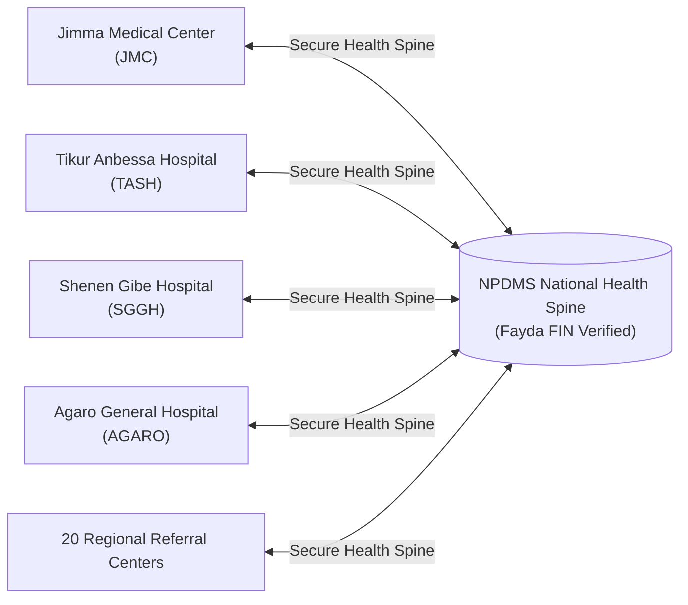

# National Patient Data Management System (NPDMS)
## Capstone Defense Portfolio & System Architecture Documentation

**Institution:** Jimma University — Department of Computer Science  
**Candidate:** Worku Fikadu  
**Project:** Final-Year Capstone Defense (November 2026)  
**System Title:** Ethiopia National Patient Data Management System (NPDMS)  
**Regulatory Framework:** FDRE Ministry of Health (MOH) · Proclamation No. 1110/2019 · HL7 FHIR R4  
**Live Production Deployments:**
- **Frontend Portal:** [frontend-three-neon-unbsgfynos.vercel.app](https://frontend-three-neon-unbsgfynos.vercel.app)
- **Backend Health Spine API:** [backend-one-ebon-72.vercel.app](https://backend-one-ebon-72.vercel.app)
- **GitHub Repository:** [github.com/WorkuFikadu/PDMS](https://github.com/WorkuFikadu/PDMS)

---

## 1. Executive Problem Statement & Motivation

Healthcare across Ethiopia currently relies on fragmented, isolated hospital paper folders or localized desktop silos. When a patient in **Jimma Medical Center (JMC)** is referred to **Tikur Anbessa Specialized Hospital (TASH)** or **Shenen Gibe Hospital**, the receiving clinical team has zero visibility into:
- Prior surgical interventions and longitudinal diagnoses
- Documented life-threatening drug allergies (e.g., penicillin anaphylaxis)
- Current prescription regimens, leading to dangerous duplicate pharmacotherapy
- Childhood vaccination records and maternal antenatal milestones

**NPDMS addresses this systemic gap** by establishing a nationwide, privacy-preserving Health Information Exchange (HIE) anchored to the **Ethiopian Fayda National Digital Identity (FIN)**.

---

## 2. Key Architectural Innovations

### A. Hospital-First Authentication Architecture
- Clinicians log in by selecting their **Healthcare Institution (20 Ethiopian hospitals)** and **Clinical Department Role** (*Specialist Physician, Triage Nurse, Clinical Pharmacist, Laboratory Technologist, Admissions Officer, Medical Director*).
- Eliminates hardcoded doctor names in favor of departmental role-based access control (RBAC).

### B. Multi-Modal Fayda Digital Identity (MOSIP-Compliant)
- **12-Digit FIN / FAN Lookup:** Anchors medical histories to verified national digital identity.
- **Ethio Telecom SMS OTP Authentication:** 6-digit one-time code delivered to the practitioner's or patient's phone with 10-minute validity.
- **Biometric Thumbprint Scan:** Matches optical minutiae tokens for instant emergency ID proofing.

### C. Cross-Facility Security & Emergency "Break-Glass" Access
- Doctors from outside facilities cannot view patient records without active **SMS OTP Patient Consent**.
- In life-threatening emergencies (e.g., unconscious trauma victims), clinicians can invoke **Break-Glass Emergency Protocol**, which unlocks records instantly while requiring a mandatory clinical justification and writing an immutable audit log.

### D. AI Clinical Copilot & Safety Sentinel
- **Differential Diagnosis Engine:** Suggests probable conditions based on age, gender, vitals, and chief complaints.
- **SOAP Note Summarizer:** Formats raw clinical notes into structured Subjective, Objective, Assessment, and Plan summaries.
- **Drug-Allergy Sentinel:** Automatically blocks contraindicated prescriptions (e.g., penicillins in allergic patients).

### E. Trilingual Accessibility (English, Afaan Oromoo, አማርኛ)
- Real-time language switching supporting Latin and Ge'ez typography across all clinical screens.

---

## 3. Step-by-Step Live Defense Demonstration Script

When presenting to the Jimma University defense committee, follow this sequence:

| Step | Action | Key Talking Point for Examiners |
|---|---|---|
| **1** | Open `https://frontend-three-neon-unbsgfynos.vercel.app` | Show the animated healthcare portal and trilingual toggle (**EN / OM / አማ**). |
| **2** | Select **Jimma Medical Center (JMC)** ➔ **Specialist Physician & Consultant** | Point out the hospital-first role architecture (no hardcoded names). |
| **3** | Click **"Sign In"** | Show instant JWT token authentication against the National Health Spine. |
| **4** | Switch to **"Fayda ID / Biometric"** tab | Demonstrate 12-digit FIN entry (`1985-7821-4923`) and SMS OTP verification. |
| **5** | Open **Patient Registry** (`PAT-001` Kemal Mohammed) | Show unified demographics and printable **Fayda Digital Health Card** with QR code. |
| **6** | Open **Longitudinal EHR & Clinical Timeline** | Demonstrate cross-hospital encounters from Jimma and Tikur Anbessa in one file. |
| **7** | Click **"Transfer Brief"** | Show the formatted inter-hospital referral document with MOH crest and active diagnoses. |
| **8** | Click **"Export FHIR"** | Show compliance with international **HL7 FHIR R4** interoperability standards. |
| **9** | Open **Emergency Blood Bank** | Show national blood inventory tracking across blood groups (O+, A-, etc.). |
| **10** | Open **Audit Trail** | Demonstrate Proclamation No. 1110/2019 compliance with tamper-evident audit logs. |

---

## 4. Examiner Defense Q&A Preparation

### Q1: What happens if an Ethiopian rural clinic loses internet connection?
> **Answer:** NPDMS features an offline resilience mode. Local encounters are cached in the browser's persistent queue (`localStorage`). Once connectivity to Ethio Telecom is restored, the clinician clicks "Sync Now" to batch-commit the records to the spine.

### Q2: How does NPDMS prevent duplicate patient records across facilities?
> **Answer:** The system runs an automated deduplication queue utilizing phonetic matching and birthdate-telephone correlation. Candidate duplicates are flagged for administrative review before merging.

### Q3: How is patient privacy safeguarded under Ethiopian Law?
> **Answer:** Every access to an electronic health record is recorded in an append-only audit trail with the clinician's ID, timestamp, and IP address. Non-treating facilities require SMS OTP consent from the patient's registered mobile number.

---

*Prepared by Worku Fikadu for Jimma University Computer Science Faculty Capstone Defense.*
